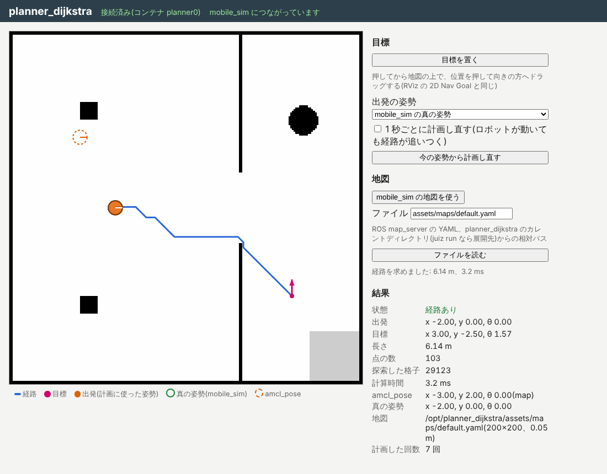

# planner_dijkstra

[mobile_sim](https://github.com/OpenJUIZ/mobile_sim) の地図の上で、ロボットの姿勢から目標の姿勢までの経路(グローバルパス)を
ダイクストラ法で求める [juiz](https://github.com/OpenJUIZ/juiz) のアプリ(juizapp)です。
障害物をロボットの半径(+ 余裕)だけ膨らませた地図(コストマップ)の上で探索し、壁のそばの格子は重みを上げるので、
経路は壁や扉の角から離れ、扉の真ん中寄りを通ります([planner_dwa](https://github.com/OpenJUIZ/planner_dwa) が追える経路)。



- 地図: ROS map_server と同じ YAML と画像(既定は mobile_sim と同じ地図)。画面の「mobile_sim の地図を使う」で mobile_sim の地図に替えられる
- 出発: トピック `amcl_pose`(`juiz_std.geometry.Pose2DStamped`、[localization_amcl](https://github.com/OpenJUIZ/localization_amcl) が出す)。画面では mobile_sim の真の姿勢も使える
- 目標: トピック `goal`(Pose2DStamped)、または画面で地図を押して向きの方へドラッグ
- 経路: トピック `path` に `{header, ok, message, start, goal, poses: [Pose2D], length, cost, expanded, time_ms, start_moved_to, goal_moved_to}` を出す。
  求まらないときは `ok: false` と `message`(目標が障害物の上、道が無い、など)
- ロボットの大きさ: 障害物の格子の中心から `robot_radius + safety_margin`(既定 0.2 + 0.05 m)以内には入らない。
  `inflation_radius`(既定 0.6 m)までは障害物に近いほど重みを上げる(`inflation_weight`、既定 2.0)。
  出発や目標がその「入れない範囲」にあるときは、空きの格子をたどって一番近い通れる格子に寄せ、
  `start_moved_to`・`goal_moved_to` に寄せた先、`message` にそのことを入れる(`ok: true`。目標を寄せたときは経路の最後の点が寄せた先)。
  ロボットより狭い隙間は通れない(`no path from the start to the goal`)

設計とマイルストーンは [docs/plan.md](docs/plan.md)。

## 動かす

juiz 0.2.5 以降と mobile_sim 0.3 系が要ります。

```sh
pip install juiz-cli==0.2.7
juiz run mobile_sim-0.3.4.juizapp        # 先に mobile_sim を動かしておく(http://localhost:8000/)
juiz run planner_dijkstra-0.2.1.juizapp  # 別の端末で
```

http://localhost:8003/ を開き、「目標を置く」を押してから地図の上でドラッグすると、経路を求めて描きます。

### Docker

```sh
docker compose -f docker/compose.yml up
```

mobile_sim(http://localhost:8000/)と planner_dijkstra(http://localhost:8003/)が一緒に動きます。
別の地図は `docker/maps/` に置き、環境変数 `PLANNER_MAP=/maps/<名前>.yaml` か、画面の「ファイルを読む」で読みます。

### 開発

```sh
cargo test --workspace
scripts/dev_plugin.sh                         # app/plugins/<target>/ にプラグインを置く
(cd ../mobile_sim && scripts/dev_plugin.sh && cd app && juiz -f app.conf -d --ipc mobile_sim)
cd app && juiz -f app.conf -d                 # 別の端末で
python3 scripts/integration_test.py --mobile-sim ../mobile_sim --ui ui_test.png   # 結合テストと画面のテスト
scripts/pack.sh                               # dist/ に .juizapp を作る
```

## juiz の ContainerProcess

コンテナ `dijkstra_planner`(app.conf では `planner0`):

| 名前 | 引数 | 戻り値 |
| --- | --- | --- |
| `planner_set_start` | `pose: Pose2DStamped` | なし(トピック `amcl_pose` を受ける) |
| `planner_set_goal` | `goal: Pose2DStamped` | 経路(トピック `goal` を受け、`path` に出す) |
| `planner_plan` | `start: Pose2D`, `goal: Pose2D` | 経路(`path` に出す) |
| `planner_get_path` | なし | 最後の経路 |
| `planner_set_map` | `image`, `resolution`, `origin`, `negate`, `occupied_thresh`, `free_thresh` | 地図の情報 |
| `planner_load_map` | `map`(YAML のパス) | 地図の情報 |
| `planner_get_map` / `planner_get_map_info` | なし | 地図の画像と情報 |
| `planner_get_costmap` | なし | 膨らませた地図の画像(障害物 0、入れない範囲 96、重みを上げる範囲 160〜250、空き 254、不明 205) |
| `planner_set_inflation` | `robot_radius`, `safety_margin`, `inflation_radius`, `inflation_weight`(null は今の値のまま) | 設定 |
| `planner_get_state` | なし | 出発・目標・経路・地図の情報(画面用) |

コンテナの引数は `map`(YAML のパス。環境変数 `PLANNER_MAP` で上書き)、`frame_id`(既定 `map`)、`allow_unknown`(不明の格子を通るか、既定 false)、`diagonal`(8 近傍か、既定 true)、
`robot_radius`(既定 0.2 m。planner_dwa の `robot_radius` と揃える)、`safety_margin`(既定 0.05 m)、`inflation_radius`(既定 0.6 m)、`inflation_weight`(既定 2.0)。
4 つとも 0 にすると、0.1.0 と同じく占有格子をそのまま探索する。

## localization_amcl とつなぐ(トピック amcl_pose)

localization_amcl と planner_dijkstra がどちらも mobile_sim だけを subsystem にした形(`juiz run` をそれぞれ動かしただけ)では、
トピック `amcl_pose` は planner_dijkstra に届きません(juiz のトピックは subsystem の木をたどって届き、葉から別の葉へは渡らないため)。
このときは画面で mobile_sim の真の姿勢を使ってください。

AMCL の推定姿勢から計画するには、[navigation_manager](https://github.com/OpenJUIZ/navigation_manager) の `navigation-manager stack` で動かします。
根の navigation_hub がトピックを中継し(`amcl_pose` → `nav/amcl_pose`)、planner_dijkstra は `nav/amcl_pose` を受けるように conf を替えて起動されます。

```sh
pip install juiz-cli==0.2.7 navigation-manager
navigation-manager stack mobile_sim-0.3.4.juizapp localization_amcl-0.1.2.juizapp \
    planner_dijkstra-0.2.1.juizapp planner_dwa-0.1.1.juizapp navigation_hub-0.3.3.juizapp
```

詳しくは [docs/plan.md](docs/plan.md#わかっている制約)。

## ライセンス

MIT OR Apache-2.0
